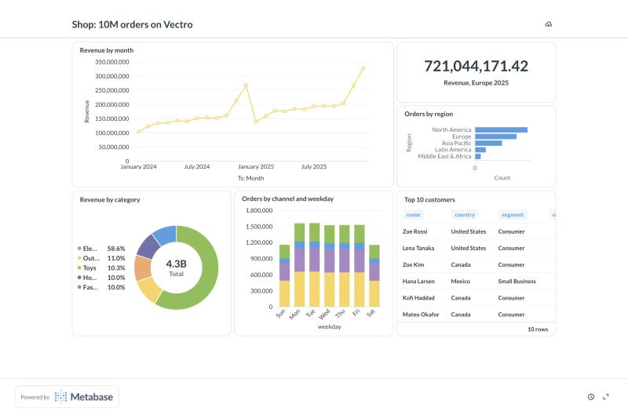

# Vectro

Multi-core analytics inside any JavaScript app. Vectro keeps data in columns
and compiles each query, filter included, into one SIMD WebAssembly loop, then
runs it on every CPU core. It runs in Node, in browsers (any page) and on
Cloudflare Workers, with no native addon, compiler or server.

> Status: prototype (0.1.0). Not published yet. Formerly "nodeplus". MIT license.

```js
import { Engine } from 'vectrojs';

const engine = new Engine();                         // all cores
const orders = engine.readCSV('orders.csv');         // parsed in parallel

orders.filter("region == 'EU' && price > 100").agg({
  orders: 'count()',
  revenue: 'sum(price * qty)',
  avgPrice: 'mean(price)',
});                                                  // ~3 ms on 10M rows

orders.groupBy('region').agg({ revenue: 'sum(price * qty)' }).toRows();
```

## What it does

- **Tables:** `engine.table({ price: Float64Array, region: string[] })`,
  `engine.readCSV(path)`, `engine.parseCSV(text | bytes)`.
- **Queries:** `filter(expr)` (lazy), `agg({ name: 'sum(expr)' | 'mean' | 'min' | 'max' | 'count()' })`,
  `sum/mean/min/max/count(expr)`, `groupBy(keys).agg(...)`, `derive(name, expr)`,
  `collect()`, `toRows(limit)`.
- **Group by any keys:** `groupBy('region')`, `groupBy(['region', 'day'])`,
  `groupBy('account_id')`. Keys are category columns or any numbers (big IDs,
  amounts, negatives; NaN is its own group, -0 groups with 0). Groups come
  back sorted by key. Small keys (a category, or whole numbers below 16.7M,
  alone or combined) are group numbers as they are. Other keys are numbered
  by every thread at once in one shared hash table (compare-and-swap inserts),
  and with many groups each thread adds up its own range of groups. On 10M
  rows vs DuckDB (`compare/bench-groupby.mjs`, answers checked):

  | Keys | Vectro | DuckDB |
  |---|---|---|
  | region + day (2,920 pairs) | 8 ms | 34 ms |
  | price (100K amounts) | 38 ms | 41 ms |
  | account (1M big IDs) | 153 ms | 65 ms |
  | account + region (5.7M pairs) | 647 ms | 119 ms |

  With millions of groups, about half of Vectro's time is sorting the groups
  by key (DuckDB returns them unsorted) on one thread.
- **Missing values** are NaN and follow SQL's rules: `sum`, `mean`, `min`
  and `max` skip them (`mean` divides by the values present; `min`/`max` of
  nothing is NaN), `count(x)` counts the values present and `count(x > 5)`
  the rows where the condition holds. `isMissing(x)` and
  `coalesce(x, y, 0)` (first value present) work in any expression. CSV
  blanks, JSON `null` and Arrow nulls load as missing.
- **Dates and times:** a date column holds milliseconds since 1970 (UTC).
  Arrays of `Date` objects become date columns (or `table(cols, { dates:
  ['ts'] })` for ms or ISO text); CSV columns of ISO dates are found by
  themselves (or `types: { ts: 'date' }`); Arrow dates and timestamps load as
  dates; streams take `columns: { ts: 'date' }` (ISO text or ms). Compare with
  ISO text, `filter("ts >= '2024-03-01'")`, `date('2024-03-01T12:00:00Z')`, or
  a `Date` param. `year(ts)`, `month(ts)`, `day(ts)`, `hour(ts)`, `minute(ts)`,
  `second(ts)`, `weekday(ts)` (1 = Monday) and `dayStart(ts)`, `hourStart(ts)`,
  `weekStart(ts)`, `monthStart(ts)` compile to plain arithmetic in the fused
  kernels: `sum(year(ts))` over 10M rows takes 26 ms (a JS loop with `Date`:
  800 ms). Rows come back with `Date` objects; Arrow writes `Timestamp(ms, UTC)`.
- **Distinct counts:** `countDistinct(expr)` in `agg` and `groupBy().agg`
  (`{ customers: 'countDistinct(customer_id)' }`), exact; missing values (NaN)
  don't count, as in SQL. On split tables and streams the workers' distinct
  values are merged exactly. `approxDistinct(expr)` gives the same answer on a
  table, and on split tables, streams and **live windows** it uses HyperLogLog
  sketches (4 KB, within ~1.6%): each worker keeps one per time slice and
  group, and sketches merge, so "distinct customers in the last 5 minutes" is
  a cheap read. `DistinctSketch` (exported) builds, merges and ships sketches
  yourself. On 10M rows vs DuckDB (`compare/bench-distinct.mjs`): 365 days
  4 ms vs 5; regions per day 9 ms vs 34; 1M accounts 81 ms vs 48; accounts per
  region (5.7M pairs) 214 ms vs 100.
- **Compressed columns:** `table.compress()` (or `engine.table(cols, { compress:
  true })`, `parseCSV(text, { compress: true })`) stores each number and
  category column in 1, 2 or 4 bytes per row when every value comes back
  exactly: small counts and category codes in 1 byte, prices in cents and
  timestamps on whole seconds in 4, missing values as a reserved code. It is in
  place (views keep working) and checked value by value with the kernels' own
  arithmetic, so answers never change. The fused kernels read packed columns
  directly (SIMD widen, convert, scale), so do group-by kernels; sort, top and
  join copy the codes, so results stay small; other operations decode what
  they need. 10M orders (`npm run bench:pack`): 458 MB → 143 MB (3.2x smaller),
  compressed in 0.34 s; queries run about as fast as on plain columns (a new
  column 4.0 → 3.0 ms, filtered revenue 2.4 → 2.9 ms, group by region 4.7 →
  4.4 ms, top 10 8.4 → 12.9 ms). The whole test suite also runs with every
  table compressed (`npm run test:compressed`).
- **SQL:** `sql(text, { orders, customers })` runs a SELECT over your tables
  and returns a lazy query (`.toRows()`, `.collect()`, `.explain()`):

  ```js
  import { sql } from 'vectrojs';
  sql(`SELECT c.tier, COUNT(*) AS n, SUM(o.price * o.qty) AS revenue
       FROM orders o JOIN customers c ON o.cust = c.cust
       WHERE o.region = 'EU' AND o.ts >= DATE '2024-01-01'
       GROUP BY c.tier HAVING COUNT(*) > 100 ORDER BY revenue DESC LIMIT 5`,
      { orders, customers }).toRows();
  ```

  SELECT [DISTINCT], FROM with aliases, [INNER | LEFT | RIGHT | FULL [OUTER]
  | CROSS] JOIN ... ON / USING, WHERE, GROUP BY (columns, expressions, select aliases or positions),
  HAVING, ORDER BY ... ASC/DESC [NULLS FIRST | LAST], LIMIT / OFFSET / FETCH
  FIRST; COUNT(*), COUNT(x), COUNT(DISTINCT x), SUM, AVG, MIN, MAX,
  APPROX_COUNT_DISTINCT, MEDIAN, PERCENTILE_CONT / PERCENTILE_DISC WITHIN GROUP
  (ORDER BY x), QUANTILE_CONT anywhere in SELECT / HAVING / ORDER BY; BETWEEN,
  IN, LIKE, IS [NOT] NULL, CASE, %, COALESCE, NULLIF, ROUND, LEAST, GREATEST,
  CAST, DATE / TIMESTAMP literals, INTERVAL '7 days', EXTRACT, DATE_TRUNC,
  YEAR(), MONTH()... It compiles to the planner below, so SQL gets every
  optimization, on tables and on datasets bigger than memory.

  **Subqueries and set operations:** WITH (CTEs, with column names too),
  subqueries in FROM and JOIN, UNION [ALL] / INTERSECT / EXCEPT, SELECT
  without FROM, and in expressions IN (SELECT ...), EXISTS (SELECT ...) and
  (SELECT one value), correlated too when the link is an equality (`WHERE
  o.cust = c.cust`). Every subquery becomes a join, so the whole statement is
  one plan with no row-by-row loops.

  **Window functions:** `f(...) OVER ([PARTITION BY ...] [ORDER BY ...] [ROWS
  | RANGE BETWEEN ... AND ...])` with ROW_NUMBER, RANK, DENSE_RANK,
  PERCENT_RANK, CUME_DIST, NTILE, LAG, LEAD, FIRST_VALUE, LAST_VALUE,
  NTH_VALUE, SUM, AVG, MIN, MAX, COUNT; frames by rows or by value (`RANGE
  BETWEEN INTERVAL '6 days' PRECEDING AND CURRENT ROW`), over grouped results
  too (`RANK() OVER (PARTITION BY region ORDER BY SUM(qty) DESC)`). Running
  and moving sums use prefix sums, and moving MIN / MAX use a monotonic queue,
  so each window costs one pass after its sort.

  ```js
  sql(`SELECT region, cust, spend FROM (
         SELECT region, cust, SUM(price) AS spend,
                RANK() OVER (PARTITION BY region ORDER BY SUM(price) DESC) AS r
         FROM orders WHERE cust IN (SELECT cust FROM customers WHERE tier = 1)
         GROUP BY region, cust) t
       WHERE r <= 3 ORDER BY region, spend DESC`, { orders, customers }).toRows();
  ```

  **Text:** UPPER, LOWER, TRIM / LTRIM / RTRIM (and `TRIM(LEADING 'x' FROM
  s)`), SUBSTRING / SUBSTR (and `FROM ... FOR`), LEFT, RIGHT, LENGTH,
  REPLACE, REVERSE, REPEAT, LPAD, RPAD, SPLIT_PART, STRPOS / POSITION(a IN
  b), STARTS_WITH, ENDS_WITH, CONTAINS, CONCAT, CONCAT_WS, `||`, ASCII, CHR,
  REGEXP_MATCHES / REGEXP_REPLACE / REGEXP_EXTRACT, STRFTIME, ILIKE, text
  CASE / COALESCE / NULLIF, `CAST(x AS VARCHAR)` and text to numbers or
  dates, and comparing text with `<` / `>`. Each function runs once per
  distinct value, not per row (a category column has few labels), and the
  answer is a category column again, so it groups, sorts and joins like any
  other: `GROUP BY UPPER(region)` on 10M rows 31 ms (DuckDB 40), `region ||
  '-' || qty` as a key 84 ms (88), `STRFTIME(ts, '%Y-%m')` 48 ms (59; times
  are rounded to the month first), ILIKE on a column 30 ms (45). Missing text
  is `''`, as everywhere in Vectro, and positions count characters from 1 as
  in DuckDB.

  **Outer joins:** RIGHT and FULL JOIN (with ON or USING) are the matching
  rows (FULL: plus the left rows without a match) followed by the right rows
  whose keys no left row has; slower than DuckDB for now (RIGHT JOIN + group
  90 vs 53 ms, FULL JOIN + count 59 vs 26 ms).

  `compare/check-sql.mjs` runs 40 such queries (CTEs, set operations,
  correlated subqueries, windows, percentiles, text functions on awkward
  strings, outer joins, missing values) in Vectro and DuckDB on the same
  200K rows; every answer is the same. Not yet: INTERSECT ALL / EXCEPT ALL,
  correlation on anything but equalities, MIN / MAX of text, and STRING_AGG.
  The MCP server has
  a `sql` tool. The same SQL text vs DuckDB on 10M orders + 100K customers
  (`compare/bench-sql.mjs`, answers checked): filtered totals 3.0 vs 9.5 ms,
  group by region 6.6 vs 31.8 ms, join + filter + group 21.4 vs 30.6 ms, top 10
  customers 9.8 vs 45.0 ms, top 20 rows 8.7 vs 24.5 ms, CASE inside SUM 6.0 vs
  36.7 ms; distinct customers per month is slower (144 vs 74 ms). The new
  parts, same run: correlated subquery 17.6 vs 57.6 ms, IN (subquery) 30.8 vs
  27.5 ms, top 3 per region with RANK 131 vs 127 ms, running total by day 18.6
  vs 15.3 ms; slower: MEDIAN per region 165 vs 78 ms and ROW_NUMBER over all
  10M rows 416 vs 213 ms (a full sort, on one thread). Window functions and
  percentiles gather all their rows, so on a dataset they need its rows (the
  columns used) to fit in memory.
- **Lazy queries (a planner):** `t.lazy()` records a chain (`filter`, `derive`,
  `select`, `join`, `groupBy().agg`, `sort`, `limit`/`top`) and optimizes it as a
  whole before running it with `collect()`, `toRows()`, `agg()` or `count()`
  (and `…Async`). Derived columns are inlined where they are used (never built
  unless needed as a column, and then only for matching rows); filters move
  below derives, selects and sorts, below `groupBy` when they only use its
  keys, and into each side of a join; joins and sorts copy only the columns
  used later; `sort` + `limit` becomes top-k. `explain()` prints the plan.
  Every kernel also computes constant parts once and repeated parts once per
  row (`sum(year(ts))`: 26 → 7.5 ms). `npm run bench:plan`, 10M orders, step by
  step vs lazy: derive + filter + total 19.8 → 2.9 ms; join then filter 144 →
  22 ms; sort then first 10 177 → 12 ms.
- **Joins:** `orders.join(customers, { on: 'customer_id' })`, several keys
  (`on: ['region', 'day']`), different names (`on: { left: 'cust', right: 'id' }`),
  `how: 'inner'` (default) or `'left'`. Put the smaller table on the right: its
  keys go into one hash table built on every thread, then every left row looks
  its key up on every thread, and the joined columns are gathered on every
  thread. Text keys match by label; a missing (NaN) key never matches; a left
  join fills unmatched right columns with NaN or `''`. Rows come in left-table
  order. On 10M orders vs DuckDB (`compare/bench-join.mjs`, joined table built
  in full, answers checked):

  | Join | Vectro | DuckDB |
  |---|---|---|
  | × 100K customers | 118 ms | 195 ms |
  | × 1M accounts | 231 ms | 254 ms |
  | left join, half the keys match | 170 ms | 194 ms |
  | two keys: region + day (2,920 rows) | 85 ms | 183 ms |
- **Text functions** on category columns: `startsWith(col, 'x')`,
  `endsWith`, `contains`, `in(col, 'a', 'b')` and `like(col, 'EU-%')`. They run
  once per distinct label (not per row) and become a few range checks on the
  codes, so text filters run as fast as number filters.
- **Zone maps:** each column keeps the min and max of every 16,384-row block
  (built on the first filter that uses it; streams keep them up to date as
  batches arrive). A filter with `column < number` parts skips every block
  that can't match, which pays off on time-ordered data such as logs, orders
  and streams. Exact: only blocks that provably fail are skipped.
- **Sort and top-k:** `sort(by)` and `top(k, by)`, e.g. `top(10, '-revenue')`
  for the 10 largest. Keys are columns or expressions (`'-(price * qty)'`),
  several keys sort in order (`['region', '-price']`), text sorts by label,
  ties keep table order and missing values come last. `top` doesn't sort
  everything: it finds a cutoff from a sample, then collects only the rows
  past it, on all cores. Split tables and streams have `topAsync`. Full sorts
  of 50,000+ rows run on every core: a parallel radix sort (11-bit digits,
  digits that never change are skipped, whole numbers sort as offsets), then
  every column is gathered in the new order on every core. Sorting 10M rows
  by `-price` takes ~130 ms (one thread: ~350 ms; a JavaScript comparator
  sort: ~4.6 s).
- **Async API:** every query has an `…Async` version that runs on the worker
  threads while your server or page keeps working.
- **Expressions** are a small, safe language: numbers, columns, `+ - * /`,
  comparisons, `&& || !`, `? :`, `abs sqrt floor ceil min max`. There is no
  `eval`, so formulas typed by users or AI models are safe to run.

## Tables bigger than memory (datasets)

A dataset is a table kept on disk, in one file, read a chunk at a time. Its
size has no limit from memory (an engine holds at most 4 GB), and it opens
instantly. Node only.

```js
engine.csvToDataset('orders.csv', 'orders.vectro');     // a CSV of any size, read in pieces (or csvToDatasetAsync)
const w = engine.createDataset('events.vectro');         // or append tables (or { column: values })
w.append(todaysEvents); w.close();
engine.writeDataset('eu.vectro', orders.filter("region == 'EU'")); // a table, or a query

const orders = engine.openDataset('orders.vectro');
orders.filter("ts >= '2024-06-01'").groupBy('region').agg({ revenue: 'sum(price * qty)' }).toRows();
await orders.lazy().join(customers, { on: 'cust' }).top(10, '-price').toRowsAsync();
sql('SELECT region, COUNT(DISTINCT cust) FROM orders GROUP BY region', { orders }).toRows();
```

- **The file:** chunks of 4M rows. Each column of each chunk is stored
  compressed (see compressed columns) and packed to the bit: a quantity 1..9
  takes 4 bits, a price in cents up to 999.99 takes 17, a column that counts
  up at a fixed step (row numbers, times every second) takes none. A chunk
  loads with one read per column, then every thread unpacks the bits back to
  the 1-, 2- or 4-byte codes the kernels read; nothing is parsed. The
  footer holds the schema, one dictionary per text column and the min / max
  of every column for each chunk and each 64K-row block.
- **Queries** are the usual lazy plans, run chunk by chunk with the same
  kernels on every core: only the columns a query uses are read, and chunks
  and blocks the filters rule out are not read at all. Totals add up across
  chunks (a mean is a sum and a count), groups merge by key, `top(k)` keeps
  the best k so far and passes the k-th value to later chunks as a filter,
  `limit` stops reading once it has its rows. With the `…Async` calls the
  next chunk is read while the current one is computed.
- **Many groups:** keys that are labels or whole-number IDs add straight into
  one array per aggregation (each thread its own range of groups); exact
  distinct counts of IDs use one bitmap. Other keys keep partial groups in
  memory and, past 8M groups, **spill** them to disk split by key range; each
  range is merged on its own (split again if still too big), in key order.
- **Joins:** the other table (or a dataset's matching rows) is the build
  side, hashed once for all chunks (IDs in a small range use a direct lookup
  array instead). When both sides are datasets and the other side has more
  than 16M matching rows, both go to disk split by key range and each range is
  joined on its own (a "grace" hash join): 100M orders x 20M accounts in 7.6 s
  with 406 MB of engine memory. Rows then come out range by range rather than
  in the left table's order.
- **Results** come back as normal tables. `writeDataset(path, query)` writes
  a query's result as a new dataset chunk by chunk, so it needn't fit in
  memory either; a full `sort` written this way is an external sort (by
  ranges of the first key).
- **In the browser** (and other runtimes without Node's files), datasets open
  read-only from a File the user picked or dropped, a Blob, or a URL (HTTP
  range requests, neighbouring reads merged): only the chunks and columns a
  query needs are fetched. Queries use the async calls.

  ```js
  import { Engine, sql } from 'vectrojs/browser';
  const engine = new Engine();
  const orders = await engine.openDataset('/data/orders.vectro');   // or input.files[0]
  await sql('SELECT region, COUNT(*) FROM orders GROUP BY region', { orders }).toRowsAsync();
  ```

  A billion rows (a 5.1 GB file) open in a page in 51 ms; "the last day"
  answers in 24 ms reading 0.3 MB; a full group-by streams 2.7 GB in 7 s
  from a local server.

  Pages also **write** datasets, into the browser's own file storage (OPFS),
  to a file the user chose (`showSaveFilePicker()`), or into memory
  (`memoryFile()`, then `.blob()`). Bytes stream to disk chunk by chunk, so a
  CSV bigger than memory converts too:

  ```js
  await engine.csvToDataset(droppedFile, 'orders.vectro', { onProgress: (p) => show(p) });
  await engine.writeDataset('eu.vectro', orders.filter("region == 'EU'"));
  const orders = await engine.openStoredDataset('orders.vectro');
  await engine.storedDatasets();   // [{ name, size }]; also storedDatasetFile(name) to download
  ```

  A 246 MB CSV (5M rows) becomes a 24 MB dataset in browser storage in
  2.8 s. Try `examples/dataset/` (serve it with
  `node examples/browser-threads/serve.mjs 8780 --data <folder of .vectro files>`).
  Spilling works in the browser too: huge group-bys, sorts written as
  datasets and joins of two big datasets put their partitions in a
  temporary folder in browser storage, removed when the query ends.
- **Also:** `append: true` adds to an existing dataset; `ds.lastRun` tells
  how many chunks and bytes a query read; `explain()` shows the plan; the MCP
  server opens `.vectro` files.

Measured against DuckDB 2.0 on its own database file, both on disk, the same
SQL on identical rows (`compare/bench-dataset.mjs`: the rows come from whole-number
formulas exact in both, answers compared; best of 3, busy laptop):

| Query | 100M rows: Vectro | DuckDB | 1 billion rows: Vectro | DuckDB |
|---|---|---|---|---|
| scan everything (count, revenue) | 49 ms | 66 ms | 549 ms | 641 ms |
| filter: region and quantity | 84 ms | 76 ms | 825 ms | 694 ms |
| the last day (1 chunk read) | 1 ms | 1 ms | 1 ms | 4 ms |
| group by region | 120 ms | 126 ms | 1.27 s | 1.27 s |
| top 10 of 1M customers | 531 ms | 502 ms | 5.53 s | 6.73 s |
| top 10 rows by price | 131 ms | 90 ms | 2.77 s | 0.87 s |
| join 1M customers, group by tier | 154 ms | 72 ms | 1.55 s | 0.62 s |
| distinct customers per region | 251 ms | 520 ms | 2.57 s | 7.79 s |
| file on disk | 0.5 GB | 0.5 GB | 5.1 GB | 5.4 GB |
| peak memory (RSS) | 380 MB | 3.2 GB | **0.3–0.4 GB** | 4.5–5.6 GB |

A billion rows would take 37 GB as plain columns in memory (this laptop has
16 GB); Vectro's engine never used more than 245 MB for them. On this busy
machine runs differ by up to 2x, so the billion-row column is each system's
best of two runs. Vectro is level or faster on 5 of the 8 queries; DuckDB is
still faster at picking the top rows (3x) and at joins (2.5x) on data this
big.

## SQL over HTTP: Excel, Power BI, Google Sheets, pandas

```sh
npx vectro serve --root ~/data        # every CSV, TSV, JSON-lines, Arrow / Feather and .vectro file is a table
curl 'http://127.0.0.1:8787/sql?q=SELECT region, COUNT(*) AS n FROM orders GROUP BY 1&format=csv'
```

| Endpoint | Gives |
|---|---|
| `GET /sql?q=...` or `POST /sql` (the SQL as the body, or JSON `{ "sql": ... }`) | the answer; `format=json` (default: `{ columns, rows }`), `csv`, `ndjson` or `arrow`; `limit=n` |
| `GET /tables`, `GET /tables/<name>` | table names, rows, column types |
| `GET /tables/<name>/rows?format=csv` | a whole table |
| `POST /reload` | reads the data folder again (new files become tables) |
| `GET /odata`, `/odata/$metadata`, `/odata/<table>?$filter=...` | an OData v4 feed (below) |

- **Excel** (Windows and Mac): Data > Get Data > From Web, then the `/sql?...&format=csv` URL. **Power BI Desktop**: Get Data > Web, the same URL (Import mode; Refresh runs the query again). The Power BI Service and **Google Sheets** (`=IMPORTDATA("https://.../sql?q=...&format=csv&token=...")`) fetch from the cloud, so they need a public address or, for Power BI, a gateway.
- **OData feed** (`/odata`, OData v4): Power BI and Excel (Get Data > OData
  feed, `http://host:8787/odata`) and Tableau (OData connector) see every table
  with its column types, and their filters, column choices, sorting and
  paging run in Vectro (`$filter`, `$select`, `$orderby`, `$top`, `$skip`,
  `$count`, `$apply=groupby(...)/aggregate(...)`, pages of 50,000 rows with
  `@odata.nextLink`). With `--token`, give any user name and the token as the
  password (Basic). Checked with Microsoft's OData libraries (the CSDL
  validator and Simple.OData.Client, in `compare/check-drivers.mjs`). On 10M
  orders: a filtered page answers in 44 ms, a 50,000-row page in 0.13 s, a
  group-by in 28 ms; for importing all of a very large table, use the
  PostgreSQL connector (pages far into a table cost more).
- **pandas / Polars**: `pd.read_csv(url)`, `pl.read_csv(url)`; Arrow is ten times faster to fetch: `pyarrow.ipc.open_stream(urlopen(url + '&format=arrow')).read_all()`.
- **In your own app**: `import { serve } from 'vectrojs/serve'; await serve({ tables: { orders }, port: 8787 })`.
- **Safety**: listens on 127.0.0.1 unless `--host` is given; `--token <secret>` requires `Authorization: Bearer <secret>` (or `&token=` for tools that can't send headers); SQL here only reads; files outside the folder are never read (links that lead out are skipped).

On 10M orders: a group by region answers in 9 ms over HTTP; 1M rows export in 0.6 s as CSV (42 MB) or JSON, 0.07 s as Arrow (28 MB), and all 10M rows as Arrow in 0.45 s. Live connections (Power BI DirectQuery, Tableau, Metabase, Grafana) use the PostgreSQL protocol, below.

## The PostgreSQL protocol: Power BI, Tableau, Metabase, Grafana, psql

```sh
npx vectro serve --root ~/data --pg 5433 --user me --password secret
psql -h 127.0.0.1 -p 5433 -U me vectro
```

Vectro answers as a PostgreSQL 16 database (read only), so anything with a
Postgres connector connects live: **Power BI** (Get Data > PostgreSQL
database, server `localhost:5433`, database `vectro`; Import or DirectQuery),
**Tableau** (Connect > PostgreSQL), Metabase, Grafana, DBeaver, Excel through
ODBC, and every driver. Queries arrive in each tool's own SQL and run on Vectro's engine.

- **The protocol**: SCRAM-SHA-256 (or `--auth md5 | password`), TLS with
  `--tls-cert` / `--tls-key`, the simple and the extended query protocol
  (prepared statements, `$1` parameters, text and binary values, portals read
  a part at a time), BEGIN / COMMIT, SET / SHOW, DECLARE / FETCH cursors,
  cancel requests, PostgreSQL error codes. In code: `import { servePg } from 'vectrojs/serve'`.
- **Types**: whole-number columns are `bigint`, other numbers `double
  precision`, text `text`, dates `timestamp` (`date` when every value is at
  midnight); answers are typed the same way from the query (COUNT is bigint,
  AVG double, comparisons boolean), before any row is read.
- **The catalog**: `information_schema` and `pg_catalog` hold the served
  tables, so tools list tables and columns; the long metadata queries drivers
  send (Npgsql's type loading, pgJDBC's getTables / getColumns) are answered
  as PostgreSQL would; other catalog questions (keys, indexes, comments) get
  empty answers. psql's `\dt` and `\dn` work.
- **Checked with the real drivers** (`compare/check-drivers.mjs`): pgJDBC
  42.7.4, which Tableau, DBeaver and Metabase use, and Npgsql 4.0.17, the one
  Power BI's PostgreSQL connector ships with; both get what PostgreSQL gives,
  including Power BI's own catalog queries and folded group-bys. Neither
  Power BI nor Tableau itself has been tried yet.
- **Speed** (10M orders, same machine as a local PostgreSQL 16 with the same
  rows): a group by region answers in 20 to 80 ms through psql against
  PostgreSQL's 480 to 720 ms; 1M rows reach psql in 1.0 s (PostgreSQL 0.7 s)
  and a Java program through pgJDBC in 0.9 s (PostgreSQL 0.6 to 1.0 s).
- **Safety**: without `--password` only this machine may connect; with
  `--host 0.0.0.0` a password is required. Writes (INSERT, CREATE...) are refused.
- **Live dashboards** ([examples/bi](examples/bi/README.md): a 10M-order
  sample shop, Docker setup, and steps for Power BI, Tableau, Metabase,
  Grafana and Excel): Metabase v0.64 reads the tables and runs the questions
  its editor builds (joins included) in 80 to 600 ms; Grafana 13's
  time-series dashboard (its `$__timeFilter` / `$__timeGroupAlias` macros,
  a moving average) answers each panel in 20 to 220 ms.



## For AI assistants (MCP server)

`mcp/server.mjs` lets Claude, ChatGPT or any MCP client analyze your data
files with Vectro: it loads CSV, TSV or JSON-lines files and answers questions
on all cores, locally. It needs no dependencies.

```bash
# Claude Code
claude mcp add vectro -- node /path/to/vectro/mcp/server.mjs --root ~/data
```

```json
// Claude Desktop: claude_desktop_config.json
{ "mcpServers": { "vectro": { "command": "node", "args": ["/path/to/vectro/mcp/server.mjs", "--root", "/Users/you/data"] } } }
```

Tools: `load_file`, `list_tables`, `describe_table` (column stats, common
labels), `query` (filter, group_by, aggregates, sort, limit),
`search_similar`, `add_column`, `drop_table`. A JSON-lines file with an
embedding field (an array of numbers) also gets a vector index, so the
assistant can ask for the rows most similar to a row (or to a vector), with a
filter. The assistant can only read files under `--root`, and its
expressions are Vectro's small math language (no code runs). Mistakes come
back as tool errors the assistant can read and fix. Answers include `ms`, the
time Vectro took.

## Zone maps

`npm run bench:zones` (10M time-ordered rows, one every 10 ms, M1 Pro):

| Query | With zone maps | Without | Faster |
|---|---|---|---|
| Revenue, last hour | 0.68 ms | 4.00 ms | 5.9× |
| Revenue, last 6 hours | 1.13 ms | 3.22 ms | 2.8× |
| One hour in the middle, EU only | 0.42 ms | 3.73 ms | 8.8× |
| By region, last hour | 1.16 ms | 5.00 ms | 4.3× |
| Top 10 orders, last hour | 4.15 ms | 5.82 ms | 1.4× |

On a live stream of 7M rows (7 workers), "last minute" and "last 10 minutes"
took 0.21–0.25 ms against 1.6–1.7 ms for a full scan (6–8×). The first
filtered query on a column of a 10M-row table builds its zone maps
(~25–50 ms, once).

## Vector search

Exact nearest-neighbour search over embeddings, on every core, in any
runtime (Node, browsers, edge), with filters on any other column:

```js
import { Engine, VectorIndex } from 'vectrojs';

const index = await VectorIndex.create(new Engine(), {
  vectors: embeddings,          // number[][] or one flat Float32Array
  dim: 384,
  metric: 'cosine',             // or 'dot', 'l2'
  columns: { id: ids, title: titles, year: years },
});
await index.searchAsync(queryEmbedding, { k: 10, filter: 'year >= 2020' });
// -> [{ id, title, year, score }, ...] best first
```

Embeddings are stored as float32 columns, the score is a fused expression
computed 24 dimensions per pass with the query as scalars, and `top(k)` picks
the best, so it reuses the compiled kernels, filters and split tables (pass a
`SplitEngine` to use Web Workers on any page). It is exact, not approximate:
no index to build or tune, results identical to brute force.

`npm run bench:vectors` (M1 Pro, 384 dimensions, top 10, cosine):

| Embeddings | Vectro | Plain JS loop (Float32Array) |
|---|---|---|
| 100,000 (154 MB) | 11.7 ms | 35.9 ms (3.1×) |
| 200,000 (307 MB) | 13.8 ms | 71.5 ms (5.2×) |
| 500,000 (768 MB) | 22.8 ms | 179.3 ms (7.9×) |

With a `SplitEngine`, every worker searches its own rows in one round trip
and the page keeps the best k. In Chrome (`examples/check/vectors.html?n=200000`),
8 Web Workers took 12.4 ms against 21 ms on the page's own thread; at 50,000
vectors the two were about equal (10.1 vs 8.8 ms). Keep the tab in front when
measuring: browsers slow down hidden tabs.

`table.select(...columns)` (a narrow view, no copy) and
`splitTable.topAsync(k, by, { columns })` keep top-k cheap on wide tables.

## Streaming (prototype)

A stream is a live table spread over split-table workers. Rows arrive as CSV
lines or JSON lines and are parsed in 256 KB batches into growing columns.
Queries are the same as for any split table.

```js
import { SplitEngine } from 'vectrojs';             // browsers: from 'vectrojs/browser'

const engine = new SplitEngine({ workers: 4 });     // default: one worker per core
const orders = await engine.streamAsync({
  format: 'ndjson',                                  // or 'csv' (no header)
  columns: { ts: 'number', price: 'number', qty: 'number', region: 'category' },
  keepRows: 2_000_000,                               // or keepMs: 60_000, timeColumn: 'ts'
});

// each worker reads its own feed: nothing passes through this thread
await Promise.all(engine.workers.map((_, w) =>
  orders.connect(w, { url: `wss://feed.example.com/orders?part=${w}` })));  // or { host, port } for TCP (Node)
// ...or push chunks you receive yourself: socket.on('data', (c) => orders.push(c))

// running totals, updated as rows arrive
const live = await orders.windowAsync({
  by: 'region', every: 1000, last: 300_000, timeColumn: 'ts',
  agg: { orders: 'count()', revenue: 'sum(price * qty)', avg: 'mean(price)' },
});
await live.readAsync();                  // per region, last 5 minutes (~1 ms)
await live.readAsync({ series: true });  // per second and region, for charts

await orders.filter("region == 'EU'").aggAsync({ big: 'count(price > 900)' });  // any query, over the rows kept
const fixed = await orders.snapshotAsync();                                      // a fixed copy, for derive and toRows
```

- **JSON lines** are parsed byte by byte straight into columns (no object per
  row): keys in any order, extra and nested keys skipped, `null` and missing
  values empty, bad lines counted (`badLines`) and skipped.
- **Windows** keep one small total per (slice of `every` ms, group) in each
  worker, so reading costs about a millisecond, and the totals outlive rows
  dropped by `keepRows`. The window ends at the newest time seen.
- **Backpressure (TCP and push):** when a worker has more than 4 MB waiting to
  be parsed, it pauses its socket (or delays its reply to `push`) until it's
  down to 1 MB. TCP then slows the sender. WebSockets can't be paused, so a
  WebSocket feed faster than the workers grows their backlog.
- **Queries go first:** parsing runs one batch per event-loop turn, so a query
  waits for at most one batch.

**In a browser** (`examples/stream/`, Chrome, Web Workers each reading its own
WebSocket of JSON lines): with 4 workers it kept up with the feed's
**2 million orders per second**; with 8 workers it took in **3.5–3.6 million per
second** (the test feed, one Node thread writing JSON, is the likely limit).
The page never waited more than 4 ms, and the 30-second window read in
0.1–11 ms. Run it: `npm run serve:split`, then open
`/examples/stream/?workers=8&rate=500000`.

**In Node** (`npm run bench:stream`, M1 Pro, 7 workers, 10M rows kept,
localhost TCP, a live query every 250 ms over every kept row):

| Receiver | Rows/s taken in | Query median / max | Main thread stalled up to |
|---|---|---|---|
| Plain Node, 1 connection (split/Number parsing, a loop per query) | 3.2–3.3M | 19–20 / 23 ms | 40–41 ms |
| Vectro, 1 connection, chunks pushed to workers | 17.0–17.5M | 13–14 / 22–32 ms | 6–9 ms |
| Vectro, 1 connection per worker | 16.7–18.5M | 12–14 / 29–62 ms | 12 ms (19–47 ms on an overloaded machine) |

The producer runs on the same machine, so all 8 cores are busy. JSON lines
(`FORMAT=ndjson`): Vectro took in 9.3–10.3M rows/s against 2.45M for plain Node
using `JSON.parse` per line, with live queries at 12–14 ms (plain: 18.5 ms).

### Binary streams: Emitter and `format: 'vectro'`

When you control both ends, skip text. An `Emitter` (Node) sends column
batches as **Vectro frames**: numbers as raw float64, categories as u32 codes
with each label sent once per connection, every section 8-byte aligned. The
receiving worker copies number columns straight into memory with no parsing.

```js
import { Emitter, SplitEngine } from 'vectrojs';

// sender
const feed = await Emitter.listen({ port: 9000, columns: { ts: 'number', price: 'number', region: 'category' } });
await feed.write({ ts, price, region: ['EU', 'US', ...] });         // Float64Array / arrays, same length
await feed.write({ ts, price, region: { codes, labels: REGIONS } }); // faster: codes into a labels array

// receiver: one connection per worker; the emitter deals batches round-robin
const engine = new SplitEngine();
const orders = await engine.streamAsync({ format: 'vectro', columns: { ts: 'number', price: 'number', region: 'category' } });
await Promise.all(engine.workers.map((_, w) => orders.connect(w, { host: 'feed.local', port: 9000 })));
```

`write()` waits when every connection has 8 MB unsent (TCP backpressure), and
large batches go out in frames of at most 65,536 rows. Over WebSockets, send
each frame as one binary message. The frame layout is documented at the top of
`src/frames.mjs` (`BatchEncoder` / `FrameReader` work without the Emitter too).

**Measured** (`FORMAT=vectro npm run bench:stream`, M1 Pro, localhost, a live
query every 250 ms; the machine was busy, load average ~19, so CSV measured
5.4–6.1M rows/s at the same time instead of its usual 17M):

| | Rows/s |
|---|---|
| CSV lines, 7 workers (same busy machine) | 5.4–6.1M |
| Emitter → 7 workers, end to end (Vectro frames or Arrow) | 63–78M |
| Emitter alone (one thread, to a process that discards), labels as text / as codes | 22M / 113–117M |
| Receivers alone (pre-encoded frames from one test thread): 1 / 4 / 7 workers | 29M / 88M / 100M+ |

One sender thread is enough on one machine: frames are built without zero-filling
and category codes pass straight through, so it outruns the receivers. Sender
threads behind one redirecting port were tried (branch `experiment/threaded-emitter`)
and measured no gain.

## Apache Arrow

Vectro reads and writes Arrow IPC, the binary table format of pandas, Polars,
DuckDB, pyarrow and Arrow Flight: the stream format and the file format
(`.arrow` / `.feather`), including LZ4-compressed files. No dependencies.

```js
import { readFileSync, writeFileSync } from 'node:fs';
import { Engine, readArrow, writeArrow } from 'vectrojs';

const engine = new Engine();
const sales = engine.fromArrow(readFileSync('sales.feather'));       // or columns: ['price', 'region']
writeFileSync('eu.feather', sales.filter("region == 'EU'").toArrow({ file: true }));  // pandas.read_feather opens it
// split tables: await engine.fromArrowAsync(bytes), await table.toArrowAsync()

// streams: any Arrow IPC stream over TCP or WebSocket, e.g. from pyarrow
const orders = await split.streamAsync({ format: 'arrow', columns: { ts: 'number', region: 'category' } });
// ...or Vectro's Emitter speaking Arrow: Emitter.listen({ columns, format: 'arrow' })
```

- **Types:** ints, floats (16/32/64-bit), bools, dates, times, timestamps and
  durations become number columns (times in milliseconds, nulls as NaN);
  strings and dictionary-encoded strings become category columns (nulls as
  `''`). Lists, structs, decimals and binary are refused unless left out with
  `columns`. 64-bit integers are exact up to 2^53.
- **Writing:** numbers as float64 (float32 tables as float32), categories as
  dictionary-encoded strings, which pandas opens as `Categorical`.
- **Checked against pyarrow 26:** files pyarrow writes (every type above, nulls,
  delta and replaced dictionaries, LZ4, pandas `to_feather`) read back exactly
  (`test/fixtures/arrow`, made by `scripts/make-arrow-fixtures.py`), and pyarrow
  and pandas read Vectro's files back exactly.
- **Speed** (M1 Pro, busy machine): a 10M-row, 5-column Feather file loads in
  ~0.43 s uncompressed and ~1.1 s with LZ4 (pyarrow, with native threads:
  0.16 s / 0.07 s). Arrow streams from the Emitter: 71–75M rows/s into 7
  workers, the same as Vectro frames. ZSTD-compressed files aren't supported yet.

## Runtimes

| Import | Where | How it runs |
|---|---|---|
| `vectrojs` | Node | Worker threads on all cores, shared memory |
| `vectrojs/browser` → `Engine` | Pages with COOP/COEP headers | Web Workers, shared memory (async API) |
| `vectrojs/browser` → `SplitEngine` | Any page | Each Web Worker owns a share of the rows; async API |
| `vectrojs/portable` | Cloudflare Workers and other edge runtimes | One thread; a precompiled 11 KB module plus a vectorized interpreter |

Tested in Node 25, Chrome, Safari 26.5, Firefox 158, Safari on iOS (real
iPhone) and Cloudflare Workers.

## Performance (10M rows, Apple M1 Pro, Node)

| Query | Vectro | DuckDB 2.0 | SQLite | Arquero |
|---|---|---|---|---|
| Filtered revenue | 3.2 ms | 10.0 ms | 757 ms | 63 ms |
| Dashboard, 4 aggregates | 3.1 ms | 21.3 ms | 345 ms | 170 ms |
| Group by region (8 groups) | 7.9 ms | 33.7 ms | 2.75 s | 998 ms |
| Group by customer (100K groups) | 11.2 ms | 11.5 ms | 4.32 s | 738 ms |
| New column | 3.2 ms | 26.1 ms | 1.75 s | 128 ms |

Run them yourself: `cd compare && npm install && npm run bench`. Timings vary
with the machine's state (battery, background load), so compare systems in the
same run. DuckDB is a full SQL database and wins elsewhere: joins, files larger
than memory, quoted-CSV loading.

## Layout

```
src/         the engine (Node, browser and portable entry points); src/serve: the HTTP and PostgreSQL servers
bin/         the vectro command (vectro serve)
mcp/         the MCP server for AI assistants
dist/        vectro.wasm, the precompiled kernels for edge runtimes (npm run build)
test/        correctness tests; VECTRO_MODE=single|interp|edge|browser-sim selects a mode
bench/       Vectro-only benchmarks (threads, async, skewed filters, CSV)
compare/     Vectro vs DuckDB, SQLite and Arquero (own package.json)
examples/    browser pages (threads, split tables, correctness check, phone test)
             and a Cloudflare Worker
scripts/     build-wasm.mjs, make-check-expected.mjs
```

## Development

```bash
npm run test:all        # every test in all five modes (Node, single thread, interpreter, edge, browser-sim)
npm run bench           # Node benchmarks
npm run serve:split     # browser pages without isolation headers, port 8767
```

Browser checks: run a server, then open `/examples/check/` in a browser to run
the same queries on every engine it supports and compare them with Node's
answers.

## Not done yet

64-bit integers beyond 2^53 and time zones other than UTC. A dataset is
written by one writer at a time; a join on text keys needs its
other side to fit in memory, exact distinct counts of non-ID values don't
spill, and `approxDistinct` on a dataset counts exactly. Joins are for normal
tables (not split tables or streams yet), inner and left only. Split tables
have `topAsync` but no full sort.
Binary streams have number and category columns only; Arrow ZSTD compression isn't supported.
Streams take flat records only (no nested JSON fields), and windows group by
at most one category column. Memory is capped at 4 GB per engine (datasets go past it) and freed with `dispose()`.
