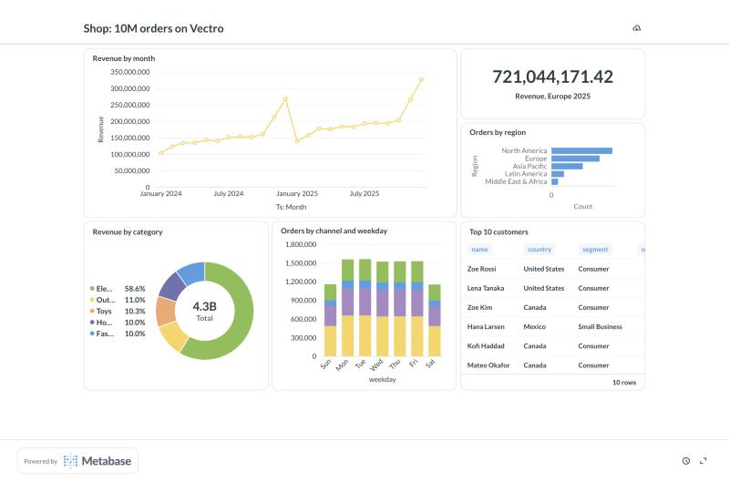
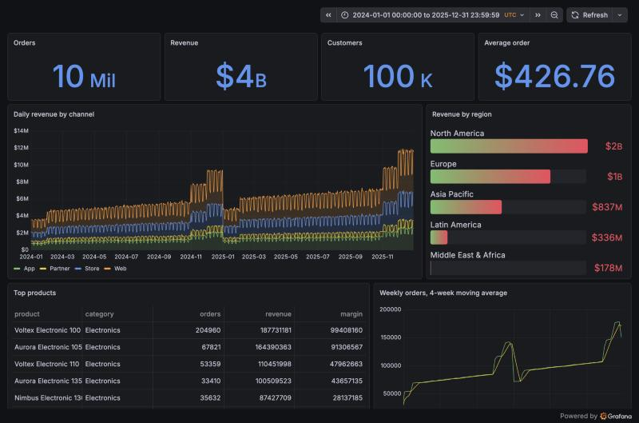

# Vectro in BI tools: Power BI, Tableau, Metabase, Grafana, Excel

Vectro serves a folder of files as a PostgreSQL 16 database (read only), so
BI tools connect to it with their built-in PostgreSQL connector, live. This
folder has a sample shop, a Docker setup for Metabase and Grafana, and the
steps for each tool.




## 1. Data and the server

```sh
node examples/bi/make-data.mjs bi-data                  # 10M orders (.vectro on disk), 100K customers, 500 products: about 10 s
export VECTRO_PG_PASSWORD='choose-a-password'
npx vectro serve --root bi-data --pg 5433 --user bi --database shop
```

Every CSV, TSV, JSON-lines, Arrow and `.vectro` file in the folder is a table
named after its file. Text columns load as categories, so tools can group,
filter and join on them (free text above 5M rows stays as it is).

- From the same machine: host `localhost`, port `5433`, database `shop`, user `bi`.
- From Docker containers or other machines: add `--host 0.0.0.0` (a password
  is then required) and connect to `host.docker.internal` or the machine's address.
- Encryption: `--tls-cert cert.pem --tls-key key.pem`. Without them, turn the
  tool's "encrypt / require SSL" option off.
- `--log-queries` prints every statement a tool sends, for finding what a
  tool asks that Vectro doesn't answer yet.

## 2. Metabase and Grafana (Docker)

```sh
cd examples/bi
VECTRO_PG_PASSWORD="$VECTRO_PG_PASSWORD" docker compose up -d      # (start Vectro with --host 0.0.0.0 first)
```

- **Grafana** (http://localhost:3001): the Vectro data source and the "Shop:
  10M orders on Vectro" dashboard are set up from `grafana/`, with anonymous
  view access. Time-series panels use Grafana's macros (`$__timeFilter`,
  `$__timeGroupAlias`), which become plain SQL Vectro runs.
- **Metabase** (http://localhost:3000): create the first admin account, then
  Admin > Databases > Add database > PostgreSQL: host
  `host.docker.internal`, port `5433`, database `shop`, user `bi`, the
  password. Metabase reads the tables and columns (with their types) and its
  query builder works: its questions become SQL that Vectro answers.

Measured on this sample (10M orders, a laptop): Metabase questions built in
its editor, including a join to products, answer in 80 to 600 ms end to end;
Grafana's eight panels in 20 to 220 ms each.

## Packaged connectors

[connectors/](../../connectors/README.md) has `Vectro.mez` (Power BI) and
`vectro.taco` (Tableau): Vectro by name in each tool's connection list. The
steps below use the tools' built-in PostgreSQL connectors instead, which need
nothing installed.

## 3. Power BI Desktop (Windows)

1. Get Data > **PostgreSQL database**.
2. Server `localhost:5433` (or `machine:5433`), Database `shop`.
3. **Import** loads the rows into Power BI (fine up to a few million rows);
   **DirectQuery** leaves them in Vectro and sends a query for every visual,
   which is where Vectro's speed shows on large data.
4. Credentials: the **Database** tab, user `bi` and the password.
5. If Power BI says the connection is not encrypted: start Vectro with
   `--tls-cert` / `--tls-key` (a certificate Windows trusts), or uncheck
   "Encrypt connection" in File > Options > Data source settings for this source.
6. The Navigator lists `public.orders`, `public.customers`, `public.products`.

Power BI's connector uses the Npgsql 4.0.17 driver; `compare/check-drivers.mjs`
runs that driver against Vectro with Power BI's own catalog queries. For
the Power BI Service (scheduled refresh, DirectQuery in the browser), the
on-premises data gateway connects to Vectro the same way; the gateway machine
must reach Vectro's port.

## 4. Tableau Desktop (Windows and Mac)

1. Connect > To a Server > **PostgreSQL**. If Tableau asks for a driver, it
   links to the PostgreSQL JDBC driver; put the `.jar` in Tableau's
   `Drivers` folder.
2. Server `localhost`, Port `5433`, Database `shop`, Authentication
   "Username and Password", user `bi`, the password; leave "Require SSL" off
   unless Vectro has a certificate.
3. Drag `orders` (and `customers` / `products` to relate them on
   `customer_id` / `product_id`). **Live** sends queries to Vectro;
   **Extract** copies the rows into a Tableau extract.

Tableau uses the pgJDBC driver, which `compare/check-drivers.mjs` checks
(schemas, tables, columns, prepared statements, cursors).

## 5. OData feed: Power BI, Excel and Tableau with no driver

The HTTP server (`--port 8787`, on unless `--no-http`) also serves OData v4 at
`/odata`. Power BI and Excel: Get Data > **OData feed**, URL
`http://localhost:8787/odata`; Tableau: Connect > To a Server > **OData**.
Each table appears with its column types; filters, chosen columns, sorting
and the first rows are worked out by Vectro, a page of 50,000 rows at a time.
With `--token secret`, sign in with **Basic**: any user name, the token as
the password. OData is best for filtered or summarised data (Import mode);
for live dashboards on large tables, the PostgreSQL connector above is faster.

## 6. Excel, Google Sheets, pandas (no driver)

Start the HTTP server too (`--port 8787`, it runs unless `--no-http`):

- Excel: Data > Get Data > From Web:
  `http://localhost:8787/sql?q=SELECT region, COUNT(*) AS n FROM orders GROUP BY 1&format=csv`
- pandas: `pd.read_csv('http://localhost:8787/sql?q=...&format=csv')`.

## What to expect

- Read only: tools can't write back (INSERT, CREATE TABLE... are refused).
  Tableau's temporary tables for some filters are refused too; it falls back to plain queries.
- Catalog questions about keys, indexes and comments get empty answers (there are none).
- Not tried yet with the real applications: Power BI and Tableau themselves
  (only their drivers). If something fails, run Vectro with `--log-queries`
  and send the statement it shows.
